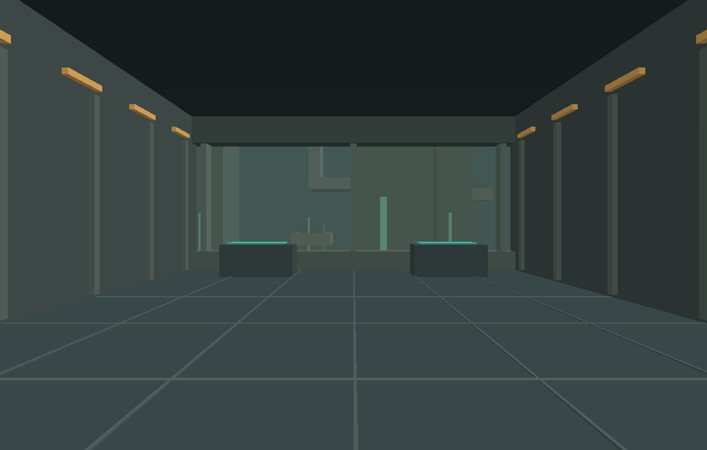
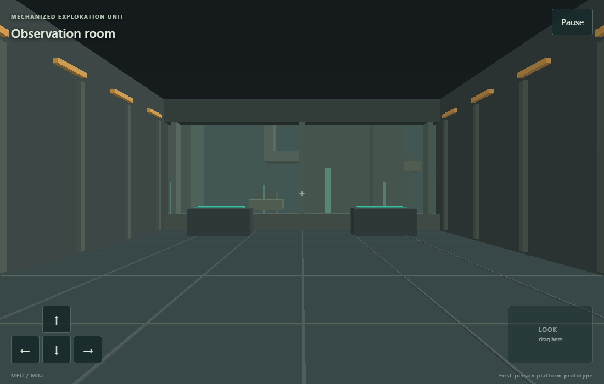
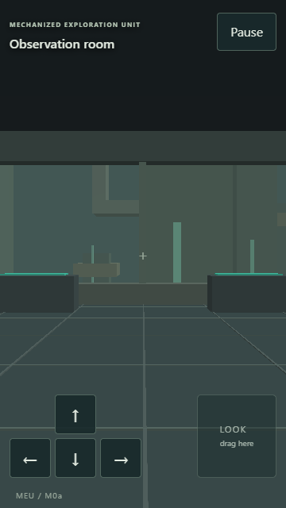
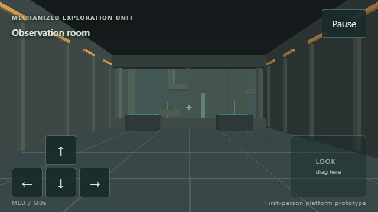

# M0a Foundation Evidence

Implementation date: 3 November 2026. Scene: `m0a-room-v1`; content version 1. User acceptance is pending. This covers M0a, not the whole M0 foundation.

## Implemented

- C17 simulation and camera math separated from SDL/presentation.
- Native, dependency-free test, and Emscripten CMake targets with pinned tools and SDL source checksum.
- A first-person room rendered with direct OpenGL 3.3/WebGL 2, bounded walking, looking, and flat retro geometry.
- Shared C actions behind desktop SDL input and the browser keyboard/pointer/touch adapter.
- Fixed 60 Hz simulation, bounded catch-up, pause/resume, input clearing, and sound initialized after the start gesture.
- C unit/scenario checks, a rendered native smoke/capture, browser desktop/portrait/landscape checks, and Windows/Linux/web/specification CI.
- An optimized web build without read-only test diagnostics.

## Local verification

Local captures came from the implementation tree based on `b9eb193` and identify it as `0.0.1-b9eb193-dirty`. The completed implementation and portable setup are verified at [source commit b63850d](https://github.com/stbange/meu/commit/b63850d) by the [successful four-job CI run](https://github.com/stbange/meu/actions/runs/41627769097). CI diagnostics embed the full tested commit, including in the Linux container.

Host: Windows 11, reported version 10.0.26200, x86-64. Tool versions are in [build and test](../build-and-test.md). Local Python is 3.14.3 and Node is 24.18.0. Native rendering reports AMD Radeon(TM) Graphics and OpenGL 3.3 core, driver context string 22.20.14.220712.

| Check | Result |
| --- | --- |
| Native build and CTest | Passed: core assertions and scripted walk |
| Native OpenGL smoke | Passed: three frames; sampled RGB-sum variation 159 |
| Fresh core build directory | Passed: compiler metadata/ABI detection, compile, link, both tests |
| WebAssembly build and CTest under Node | Passed: both compiled tests |
| Real Chromium browser checks | Passed: 9 applicable tests; 3 intentional desktop/phone skips |
| Optimized web without diagnostic bridge | Passed: compiled C tests and 3 browser launch checks; diagnostic export absent |
| Clean Windows CI | Passed: pinned bootstrap, native compile/link, core and scenario |
| Clean Linux CI | Passed: native compile, core/scenario, Mesa/Xvfb render capture |
| Linux address/undefined sanitizers | Passed: core and scenario |
| Web CI | Passed: both WebAssembly test configurations, 9 browser checks, 3 release launch checks |
| OpenSpec CI | Passed: strict validation |
| Commit provenance | Passed: CI binary/browser revision checks; a deliberately mismatched local revision was rejected |

Browser checks use Playwright 1.64.1 and Chromium 156.0.8078.4 with SwiftShader. Viewports are 1100 by 700, 360 by 640, and 640 by 360 CSS pixels. This verifies software-rendered behavior and browser input paths, not physical-phone performance.

Linux uses the GCC 14.2.0 Bookworm container and Mesa 22.3.6 llvmpipe. Its rendered smoke also passed with sampled RGB-sum variation 159. The local optimized web files measured 764,912 bytes for WebAssembly and 202,231 bytes for JavaScript, before HTTP compression and excluding the small HTML/CSS/input adapter.

~~~text
python tools/build.py native --test --smoke
python tools/build.py core --build-dir build/core-clean-proof --test
python tools/build.py web --test
npm run test:web
~~~

Scenario logs record build/content/scene identity, fixture line, production command, and simulation tick. Failure output includes position, held actions, and pause state. Browser attachments add the input log, viewport, browser identity, state, screenshot, and failure trace.

## Captures

The native capture comes directly from the first-person framebuffer. Browser captures retain the player view and phone controls.

## Focused user playtest

- [ ] Start the native room, walk with WASD, and look with drag/arrows.
- [ ] Start the browser room and try portrait/landscape touch controls.
- [ ] Pause or change focus, then resume without unwanted movement.
- [ ] Review whether this platform prototype is a suitable base for M0b.

Full robot scale and moving-home comfort are not M0a acceptance claims. Four connected spaces, lift/collision, travel, saves, real Android/iPhone checks, and broader browser coverage belong to subsequent steps.
