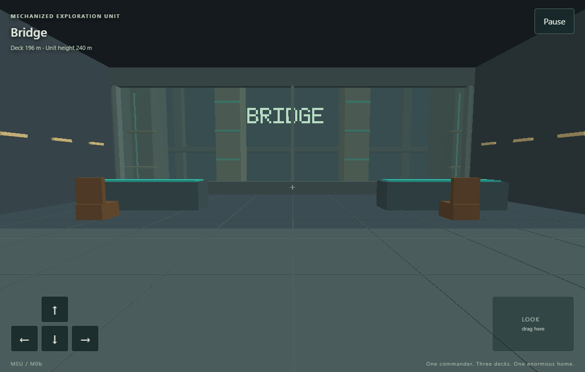
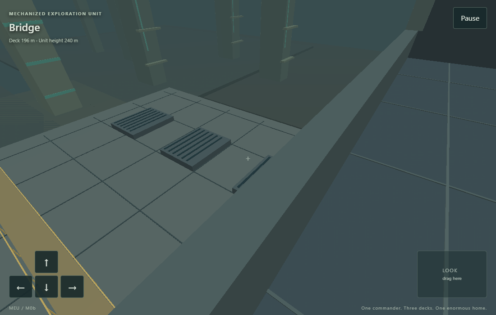
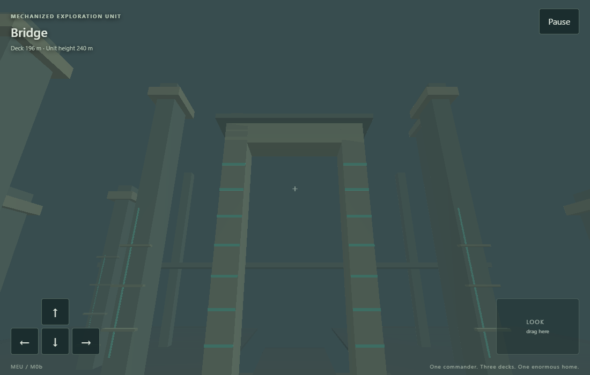
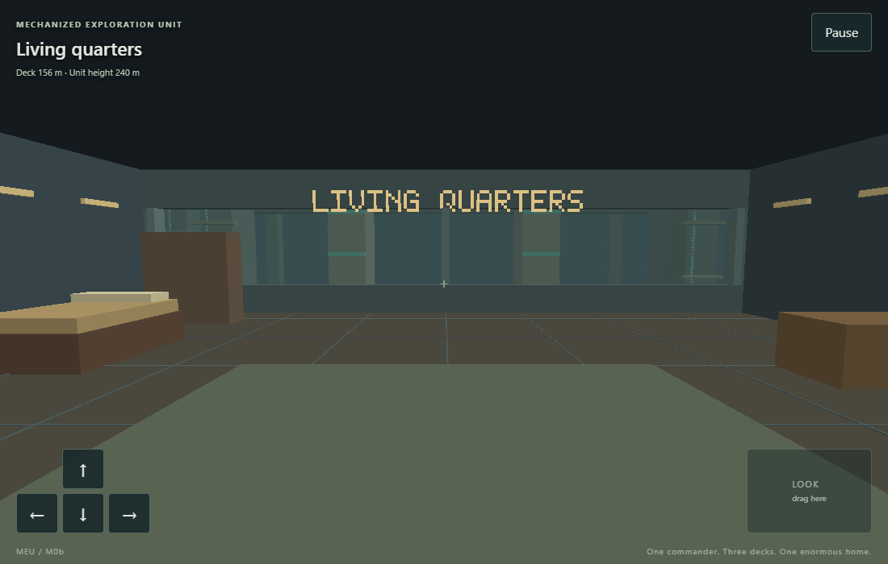
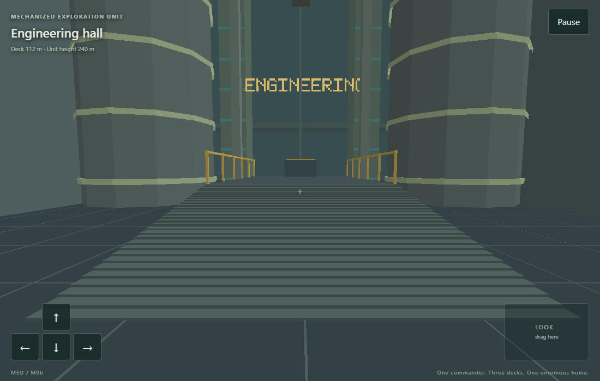
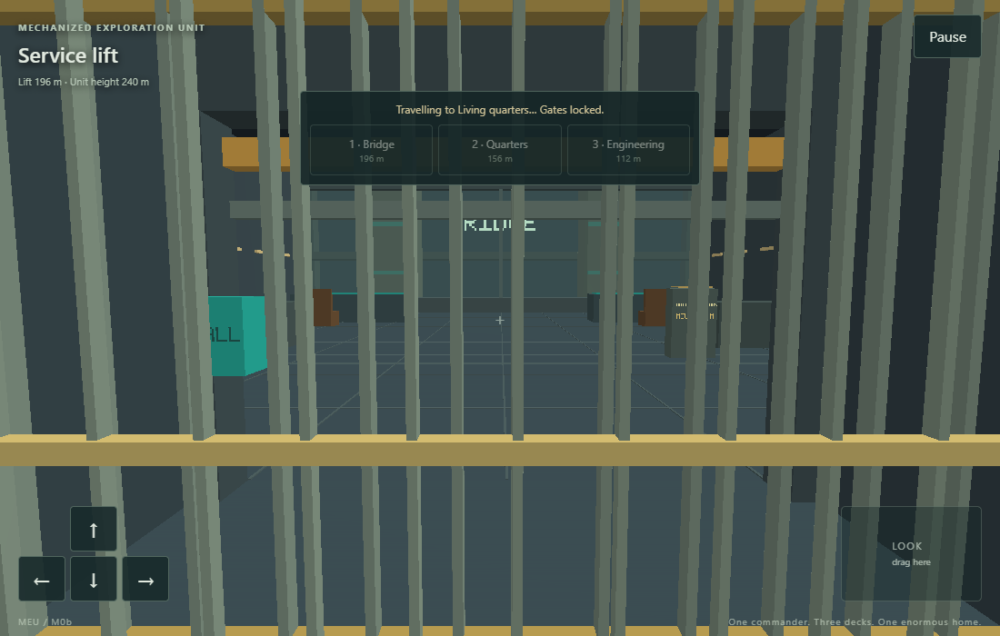

# M0b: Habitable interior and scale

Implemented on 3 November 2026 on the independent MEU branch `codex/m0b-interior`.
Implementation and automated verification do not constitute user acceptance.

## Playable scope

The first-person Commander can walk between the bridge (196 m), residence (156 m), engineering hall (112 m) and service lift in a 240 m robot. The lift travels 84 m between its extreme stops. The residence has a 2.2 m bed, desk, storage and reading lamp. Engineering has two 18 m reactors, a central ramp and a raised catwalk with 1.1 m railings. A docked maintenance robot is scenery, with no human crew.

The bridge overlooks the robot's plated forward hull, maintenance gallery, shoulders and arms, a canyon causeway and a 540 m alien doorway. This is an authored scale fixture, rather than the later generated city. All gameplay and interactions retain the Commander's physical first-person view.

WASD/mouse drag/arrows and the touch movement/look controls share the C simulation. E or the contextual touch button reads the dimensions plaque, toggles the residence lamp or toggles engineering inspection lights. The lift is behind the start position: walk backward fully into its centre, choose 1/2/3 or tap a deck, wait for arrival, then walk forward out.

## Implementation

- Shared interior geometry supplies visible furniture/structure and collision boundaries. Swept movement, footprint support and the engineering ramp prevent tunnelling, unsupported edge traversal and abrupt floor-height changes.
- The lift closes its gates before motion, rejects retargeting in transit, requires the whole Commander to be aboard for departure and blocks empty landings. Landing call panels can summon the car. Destination controls share the C boarding-readiness check and ask the Commander to step into the centre when too close to an edge. Pause freezes both the car and rider.
- Player pose and collision stay robot-local. Exterior rendering applies the inverse robot pose exactly once; the motion driver can be replaced by M0c steering. Player and cab use the same render interpolation.
- Static interior and exterior meshes plus a small dynamic lift mesh use direct OpenGL 3.3/WebGL 2. Bitmap lettering, flat materials and the existing sound placeholder keep the retro direction.

## Reproduction and results

Reference tools are unchanged from M0a: GCC 14.2.0/w64devkit 2.1.0, SDL 3.4.18, CMake 3.31.6, Ninja 1.12.1, Emscripten 6.0.10, Playwright 1.64.1 and its Chromium. Local native rendering used AMD Radeon Graphics, OpenGL 3.3 Core 22.20.14.220712 on Windows. Browser rendering used Chromium/SwiftShader at 1100×700, 360×640 and 640×360 CSS pixels.

Scene: `m0b-unit-v1`; content version: 2; application version: 0.0.2.

| Check | Result |
| --- | --- |
| `python tools/build.py native --test --tour` | Four CTest checks and the SDL/OpenGL tour passed |
| Core unit tests | 31 assertions passed: timing, pause/input cleanup, movement and camera math |
| Interior unit tests | 11,128 assertions passed: lift safety, pause, calls, collision, interaction, ramp continuity, transforms and interpolation |
| Standing motion fixture | 3,600 ticks / 60 seconds; measured robot-local drift 0.000000000 m, below the 0.02 m limit; no loss of floor support |
| Scripted interior tour | Production actions/update loop, 6,960 ticks; all four spaces visited, lift/ramp traversal and return to bridge passed |
| Rendered native tour | SDL keyboard events through the normal handler during robot translation/turn/acceleration/braking; four captures; no ejection or floor penetration |
| `python tools/build.py web --test` | All four compiled WebAssembly CTest checks passed |
| `npm run test:web` | 12 passed; three inapplicable desktop/phone variants skipped; all three full interior routes passed |
| Final desktop scale review | First-person captures of the hull and alien doorway, then the complete deck route through real input |
| `python tools/build.py web --release --test` | All four optimized WebAssembly CTest checks passed |
| Release browser launch checks | Desktop and both phone layouts; diagnostic export absent |
| `npm run spec:validate` | Strict OpenSpec validation passed |

The desktop route also checks disabled destinations and the centring prompt at the cab edge. State and input history are attached even if a route fails. The browser route uses keyboard input on desktop and browser-dispatched touch events on phones, including destination taps, mid-ride pause/resume and inspection-console use. It observes read-only C state and never teleports or writes simulation state. The committed replay fixture is [m0b-tour.txt](../../tests/fixtures/m0b-tour.txt). CI retains per-input reports, screenshots, failure traces, CTest results, binaries and source/build identity.

Initial local captures use the development working tree based on `d06e459`. Clean source revision, cross-platform CI and live publication are recorded after deployment below.

## First-person captures

## Publication and pending acceptance

The update is prepared for the repository's existing checks-and-Pages pipeline. Clean CI, published source revision and live verification are recorded here after deployment.

User review of size, novelty, comfort and room usefulness remains pending. Real-device mobile performance and Safari remain unverified; emulated viewports do not establish them. Player-controlled steering (M0c), full touch/settings work (M0d), saves (M0e), procedural city generation, repair gameplay and crafting remain future work. The foundation OpenSpec change stays open.
