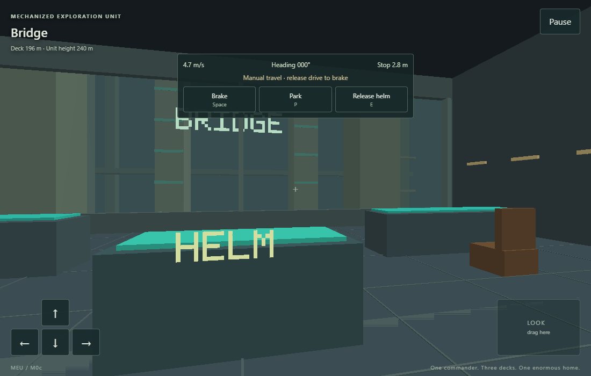
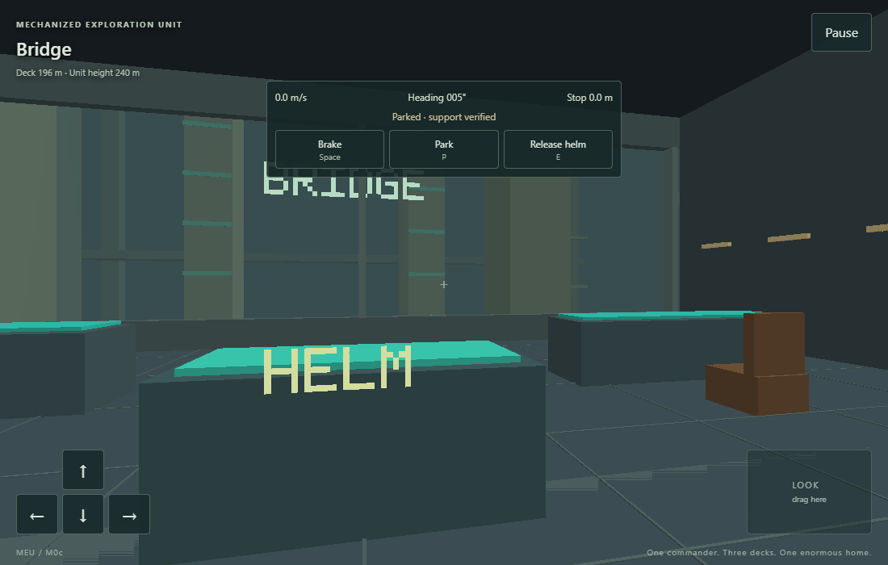
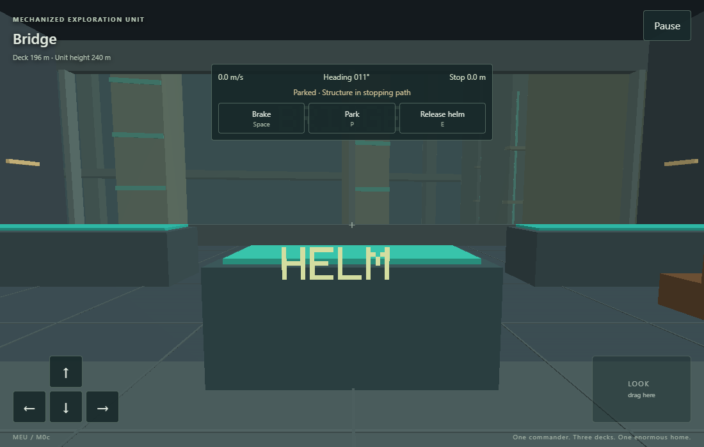
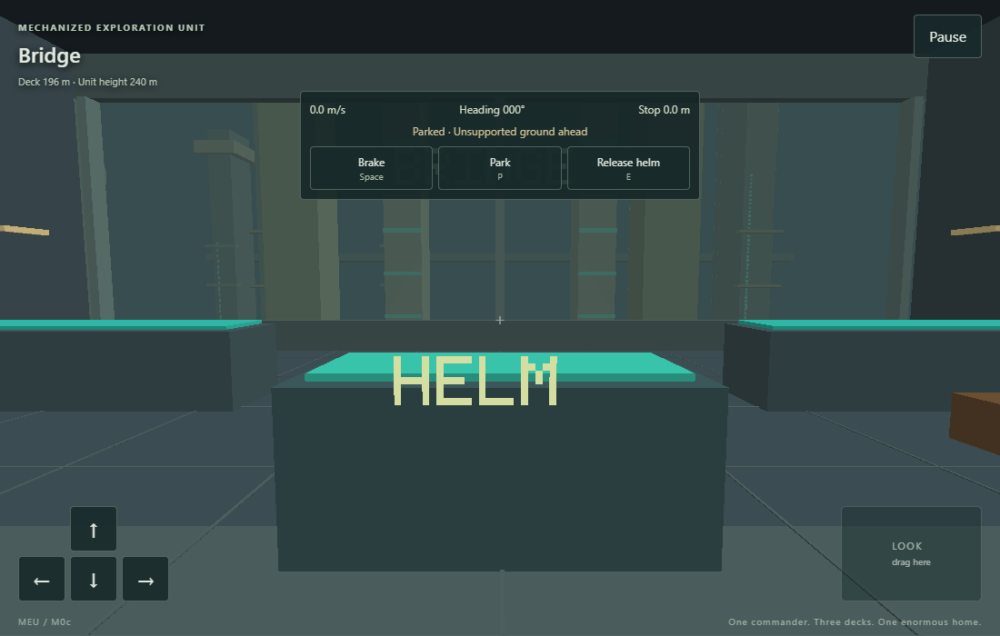
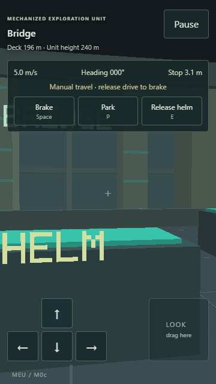

# M0c: Bridge piloting and supported travel

Implemented on 3 November 2026 on the independent MEU branch `codex/m0c-piloting`. User acceptance remains pending.

## Playable behavior

Approach the central bridge console and use E or the touch prompt. The Commander stays at that physical first-person position. W/S drives forward/reverse, A/D turns the robot, Space brakes, P requests parking and E releases the helm. Mouse drag, arrows and the touch look pad only move the view. Touch movement buttons change to drive/turn controls, with separate Brake, Park and Release helm buttons.

Drive release brakes; brake clears the previous throttle. Helm release clears travel controls and requests a parked stop while the Commander can walk aboard. Pause/focus loss relinquishes the helm, clears held actions and freezes pose, velocity and time. Explicit resume continues braking. Touch Pause also works as a second finger while drive is held.

The bridge displays speed, heading, linear braking distance and travel status. Invalid travel identifies a structure or unsupported ground; a held rejected command cannot restart movement. Parking is reported only at zero linear/angular velocity on valid support with hull clearance.

## Travel model and scope

The authored exterior shares its visible boxes with support and structure checks. Both foot areas must be completely supported, including their interiors. Conservative oriented hull bands cover the visible feet, legs, arms/shoulders, torso, forward deck and 240 m head. Each proposed movement and its full braking trajectory are checked, including rotation and reverse travel. Swept intervals enclose intermediate positions, with 2 m horizontal/overhead clearance.

Provisional tuning is 12 m/s maximum speed, 3 m/s² acceleration, 4 m/s² braking, 0.10 rad/s maximum turning and 0.25 rad/s² angular acceleration/braking. A straight stop from full speed takes 18 m plus the separately checked hull clearance. Commander collision remains robot-local; only the exterior view receives the inverse robot transform.

M0c uses continuous footprint travel on authored flat support. Free balancing, walking gait animation, generated terrain, power use and saves remain later work. A valid parked state is available for M0e to consume; no save feature is claimed. M0d still covers complete input/settings work and real-device review.

## Verification

Runtime identity: version 0.0.3, scene `m0c-travel-v1`, content version 3. Reference versions remain GCC 14.2.0/w64devkit 2.1.0, SDL 3.4.18, CMake 3.31.6, Ninja 1.12.1, Emscripten 6.0.10 and Playwright 1.64.1 with its Chromium.

| Check | Evidence |
| --- | --- |
| Core units | 31 timing, movement/input and camera assertions |
| Interior units | 11,128 collision, lift, interaction, interpolation and transform assertions; 60-second standing drift below 2 cm |
| Travel units | 6,910 assertions: helm authority, gaze independence, stopping boundaries, reverse, turn/arm/head clearance, 1 cm interior support gap, pause, release and parking |
| Controlled deceleration | Measured maximum 4.000000 m/s² in wall, cliff and reverse fixtures; every actual tick remains clear and supported |
| Native CTest | All seven unit/scenario groups passed |
| Rendered interior tour | 6,960 ticks, all four spaces, lift/ramp traversal and return to bridge during the motion fixture |
| Rendered helm tour | 1,800 ticks through SDL keyboard events; peak 12 m/s, 148.019 m travel, controlled safety stop at a visible buttress, valid parking and return to walking |
| Debug WebAssembly | All seven compiled CTest groups passed under Node |
| Release WebAssembly | All seven optimized CTest groups passed |
| Browser controls | 21 passed, three inapplicable desktop/phone variants skipped; desktop 1100×700, portrait 360×640 and landscape 640×360 |
| Release launches | All three layouts passed with diagnostic export absent |
| OpenSpec | Strict validation passed |

The fixtures [m0c-piloting.txt](../../tests/fixtures/m0c-piloting.txt) and [m0c-collision.txt](../../tests/fixtures/m0c-collision.txt) drive the production command/update loop. Unit fixtures additionally exercise unsupported gaps, stopping-distance boundaries, overhead/arm collisions, invalid support and reverse stopping.

The browser scenarios use real keyboard and touch input, with read-only C diagnostics. They take the physical helm, look without steering, park while moving, release into walking, pause with throttle held, stop at the buttress and stop before reversing off the causeway. The existing complete interior route still runs. State/input histories, screenshots and failure traces are retained. Shipping builds omit the diagnostic export. The two-finger Pause case reproduced and verified the fix for secondary touches not generating a compatibility click while drive is held.

Reproduce from the MEU checkout:

~~~text
python tools/build.py native --test --tour --pilot
python tools/build.py web --test
npm run test:web
python tools/build.py web --release --test
~~~

Then set MEU_RELEASE=1 and run `npm run test:web -- --grep "renders the C/OpenGL room"`. Linux CI additionally runs both rendered tours with Mesa/Xvfb and all seven groups with AddressSanitizer/UndefinedBehaviorSanitizer.

Local native rendering used AMD Radeon Graphics/OpenGL 3.3 Core 22.20.14.220712 on Windows. Browser automation used Chromium/SwiftShader. The static scene has 11,958 interior triangles and 2,640 exterior triangles, plus the dynamic lift/HUD. Emulation and software rendering do not establish physical-phone performance or Safari support.

## First-person captures

## Publication and acceptance

The code is prepared for the existing checks-and-Pages pipeline. Final source identity, clean Windows/Linux/web results and live publication are recorded after deployment. Local captures come from M0c development working trees.

Scale, steering feel, motion comfort and real-phone usability remain awaiting user review. M0d–M0f and full-foundation acceptance tasks remain open.
