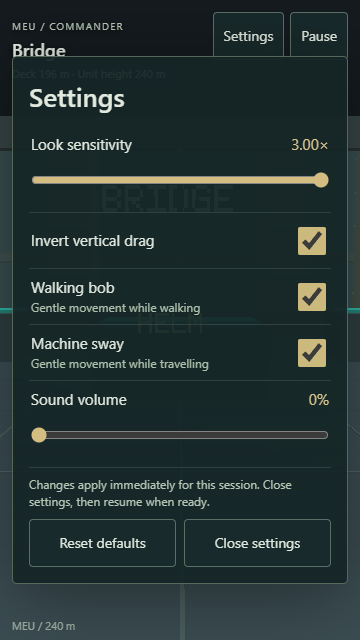
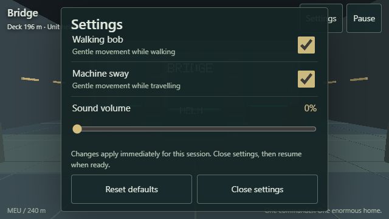
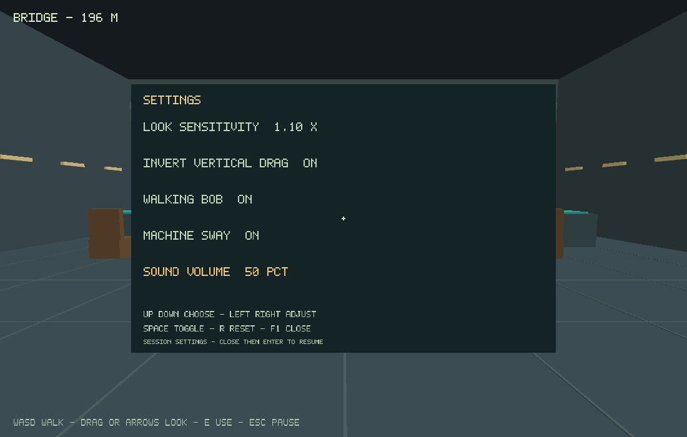
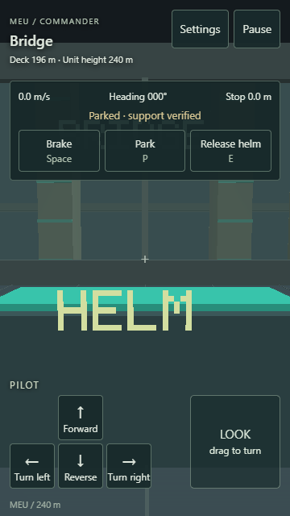

# M0d Touch, Settings and Lifecycle Evidence

Implementation date: 3 November 2026. Implementation is complete; automated verification and publication are recorded below. Physical-phone interaction/performance and user acceptance remain pending.

## Implemented behavior

The web has complete on-foot and helm controls at 360×640 and 640×360 CSS pixels. Movement labels change with context; Brake, Park, Release helm, lift destinations, contextual interactions, Pause, Settings and Begin/Resume are touch accessible. Gameplay buttons are at least 48×48 CSS pixels. A single look owner can drag while other fingers hold movement. Losing one of several owners of the same action does not cancel the others.

The C simulation owns foot, helm, panel, pause and settings contexts. Context changes clear held input and synchronously invalidate old browser gestures. Cancelled/lost capture releases its source. Old fingers cannot become throttle or walking input after helm, lift, panel or menu transitions; a new finger can explicitly resume even while old fingers stay down. Brake and Park preserve their supported stopping behavior.

Settings expose sensitivity (0.25–3×), vertical drag inversion, independent walking bob and machine sway, volume (0–100%) and Reset defaults. Both camera effects default off. Cosmetic effects change only the rendered eye, with no camera roll or changes to physical position/footing/heading. Settings pause simulation and release the helm into a requested parked stop; closing the menu stays paused. They apply for this session; durable settings are M0e.

Focus/background loss, browser freezing, viewport changes and menu pause freeze simulation and clear input. Focus return and closing settings do not resume. An explicit resume resets timing rather than replaying inactive time; an interrupted moving robot continues its reserved braking path with no old throttle. Sound initializes on the first explicit Begin gesture, after applying the selected volume. Opening/editing settings before Begin does not initialize audio.

The settings dialog respects safe areas, scrolls its fields on short screens, and keeps Close/Reset available. DOM keyboard defaults remain functional; Tab stays within the settings dialog and Escape closes it. Native F1 opens the same settings: Up/Down selects, Left/Right adjusts, Space toggles, R resets, F1/Escape closes, and Enter explicitly resumes.

## Build and scene identity

Working branch: `codex/m0d-touch-settings`, based on `bb1b666e197df04396bc7c6c78cf1b159085e749`. Local development captures and reports identify the M0d working tree as `0.0.4-bb1b666-dirty`, scene `m0d-controls-v1`, content version 4. The clean published source revision will be recorded after CI/deployment.

Tools: C17, CMake 3.31.6, Ninja 1.12.1, GCC 14.2.0 from w64devkit 2.1.0, SDL 3.4.18, Emscripten 6.0.10 from SDK manifest `d7b4130688bfa348392b921ab04015aa15c4f154`, Node 24.18.0, Python 3.14.3, Playwright 1.64.1 and OpenSpec 1.14.3. Local browser engines: Chromium 156 and WebKit 27.2 (Playwright revision 2370). Browser rendering uses software graphics. Native Windows captures use OpenGL 3.3 on AMD Radeon(TM) Graphics, driver string `22.20.14.220712`.

## Automated checks

| Check | Result |
| --- | --- |
| Native and independent headless CTest | 9 groups passed: four unit groups and five production-loop scenario fixtures |
| Focused settings C test | 39 assertions passed: defaults, clamping, invalid values, context/pause, camera isolation, moving-helm settings and braking after resume |
| Native interior/piloting/lifecycle replays | All passed through actual SDL events and OpenGL; the interior tour remains 6,960 fixed ticks and the piloting tour reaches 12 m/s before a validated structure stop |
| Debug WebAssembly CTest under Node | All 9 groups passed |
| Full Chromium/WebKit browser suite | 34 cases passed, 4 platform-inapplicable variants skipped; no retries |
| Optimized WebAssembly tests and launch | All 9 compiled groups and all 5 Chromium/WebKit launch cases passed; diagnostics absent |
| Strict OpenSpec validation | Passed |
| Clean Windows/Linux CI, sanitizers and Pages | Pending publication |

Commands from a prepared MEU checkout:

~~~text
python tools/build.py native --test --tour --pilot --lifecycle
python tools/build.py web --test
npx playwright install chromium webkit
npm run test:web
python tools/build.py web --release --test
npm run spec:validate
~~~

For the release launch suite set `MEU_RELEASE=1` and run `npm run test:web -- --grep "renders the C/OpenGL room"`. Versions and bootstrap commands are in [build and test](../build-and-test.md).

The full suite uses real C/WebGL and keyboard/pointer/touch input. A continuous route starts at the bridge, visits the residence, returns to the helm, drives/parks, visits engineering and its inspection console/catwalk, and returns to the bridge. Both phone routes use only touch. Input reports include build/scene/ticks, viewport and resulting C state; Playwright retains screenshots, error context and traces on failure.

Focused controls tests change every setting, verify inverted/scaled look and sound gain, reset defaults, check no pre-gesture sound, test safe-area insets (20 px top, 16 px bottom, 24 px sides), and operate the dialog through the keyboard. Genuine multi-finger events test simultaneous walk/look, cancellation, duplicate action owners, activated capture loss, helm transitions and three-finger pause/resume. Lifecycle tests rotate a viewport during held input, minimize the actual browser window with focus emulation disabled, freeze/unfreeze it through the browser lifecycle, and assert frozen ticks, cleared input and explicit resume. Merely opening another headless tab does not reliably background a page, so that is not used as evidence.

WebKit tests load the real WebGL client in both phone layouts and use touch to change settings, begin, pause and resume. Release tests require diagnostics to be absent. These are automated engine/viewport checks, not actual iPhone Safari or Android hardware evidence. CI retains the clean source/build identity and reports in its Windows/Linux/web/live artifacts.

## Captures

## Publication and pending review

M0d has not yet been recorded as published. The existing Pages prototype remains at [play MEU](https://stbange.github.io/meu/); publication evidence will identify the exact source and workflow after checks pass.

Physical Android Chrome and iPhone Safari interaction, browser chrome/safe areas on actual hardware, interruption by the OS, audio behavior and measured performance remain pending. No attached physical phone is available in this development session. M0f owns reference-device selection and the integrated performance/comfort review. Durable saves/settings remain M0e; this step does not complete the full foundation or archive the OpenSpec change.

Focused user review remains pending: try the residence → helm → engineering route in both phone orientations, adjust sensitivity and camera effects, interrupt a held walk/drive, and confirm readable controls, deliberate resume and comfortable motion. Record feedback explicitly before accepting the step or the full M0 experience.
