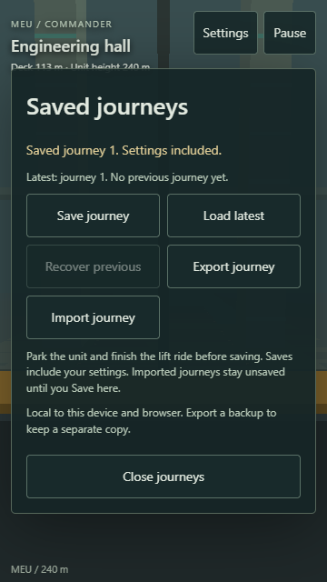
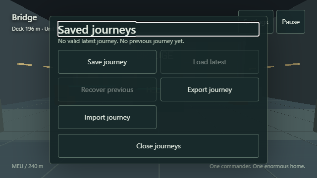
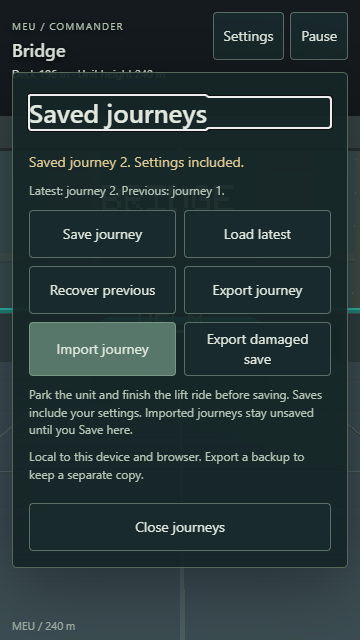
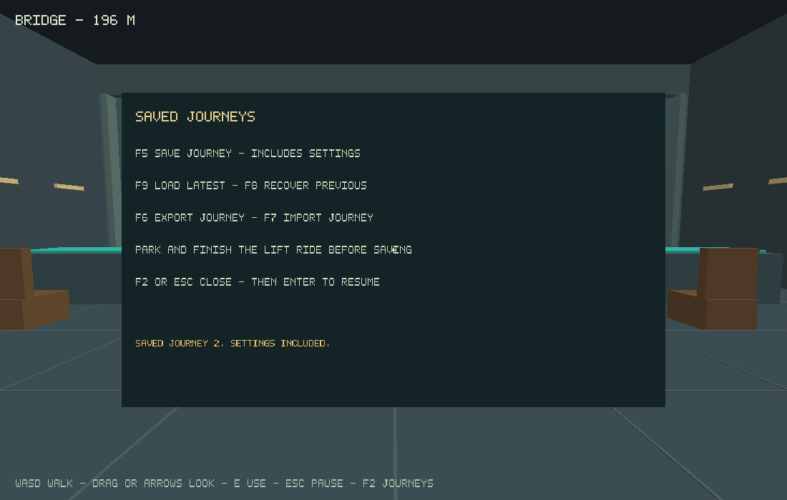

# M0e Durable Local Journeys Evidence

Implementation date: 3 November 2026. Implementation is complete; automated verification and publication are recorded separately below. Physical-device review, performance budgets and user acceptance remain pending.

## Implemented behavior

Windows/Linux and web builds share a versioned 128-byte C snapshot codec. It preserves snapshot generation and world/schema identity, robot world pose, Commander-local pose/view, room/lift location, lights, visited spaces, simulation ticks and every setting. It validates a complete staged candidate before live replacement, including finite values, settings bounds, room/lift metadata, player footing/collision and robot clearance/support. Invalid, incompatible and damaged imports leave live state and stored generations unchanged.

Save is explicit, through Pause → Saved journeys on the web or F2 on native desktop. A parked supported unit and settled lift are required. An unfinished stop/ride is rejected; close and resume to let it finish, then save. A valid latest journey restores automatically into pause on a fresh launch with travel parked, no helm/held input, no accumulated time and no sound before explicit resume. Settings are included when a journey is saved; closing settings alone does not save them.

Native storage uses an independent SDL preference directory, a process lock, flushed pending files and write-through/directory-confirmed replacement. It keeps the last complete save recoverable across write/flush/replace and interruption failures. Browser storage uses MEU's own IndexedDB database and one strict-durability read/write transaction, including concurrent-window generation allocation and previous rotation. Only transaction completion produces Saved. Put success, export, import and a failed/interrupted write do not produce a successful local-save status.

Latest and previous complete snapshots are retained. A damaged or missing latest offers explicit previous recovery without rewriting its source. A later explicit repair save preserves the most recent damaged source from each slot separately. Browser damaged-source export is available for diagnosis. Portable .meu export/import works across native and web; import replaces only the paused live journey until Save is explicitly requested. Export/import remain available when IndexedDB is denied. Export on the web reports download start, not confirmed local persistence.

The journey dialog has touch targets of at least 48 CSS pixels, a scrollable body, fixed close action, safe-area support and keyboard focus handling. Busy operations keep the game paused and prevent menu/game input from resuming behind a transaction. The native file dialog returns its selection to the main SDL thread. [Format and publication protocol](../save-format.md) records fields, compatibility, paths and recovery semantics.

## Build and scene identity

Working branch: `codex/m0e-durable-saves`, based on `3845a1a8ad988fa4390211de4a169c8c7e10e2c4`. Local captures/reports identify the implementation working tree as `0.0.5-3845a1a-dirty`, scene `m0e-saves-v1`, runtime content version 5, save schema 1 and authored-world compatibility ID 1. Implementation source: [b3733881d3c7886c4160f51e4629983d6ca22f93](https://github.com/stbange/meu/commit/b3733881d3c7886c4160f51e4629983d6ca22f93). That exact source is published and verified. Later documentation-only commits do not alter the runtime revision.

Tools remain C17, CMake 3.31.6, Ninja 1.12.1, GCC 14.2.0 (w64devkit 2.1.0 locally), SDL 3.4.18, Emscripten 6.0.10 from manifest `d7b4130688bfa348392b921ab04015aa15c4f154`, Node 24.18.0, Python 3.14.3, Playwright 1.64.1, Chromium 156, WebKit 27.2/revision 2370 and OpenSpec 1.14.3. Native Windows rendering uses OpenGL 3.3 on AMD Radeon(TM) Graphics, driver `22.20.14.220712`; browser checks use software graphics. These are verification configurations, not phone performance measurements.

## Automated verification

| Check | Result |
| --- | --- |
| Native and independent headless CTest | All 12 groups passed: five core unit groups, six production-loop fixtures and native file journal tests |
| Snapshot codec | 600 assertions and 5,000 bounded hostile payloads passed; native/WebAssembly compare the portable reference byte-for-byte |
| Native file journal | 50 Windows assertions passed; injected write/flush/replace/interruption, missing/corrupt latest, recovery, source preservation, unsupported import and UTF-8 path coverage |
| Rendered native replays | Interior, piloting, lifecycle and separate persistence write/read/export/import processes passed; personal save paths are not used |
| Debug WebAssembly CTest | All 11 groups passed |
| Full development browser regression | 49 cases passed locally and in clean CI; final CI skips 6 platform-inapplicable and 3 shipping-only variants; both touch-only engineering save/reload routes passed |
| Final save/control parser and focus checks | 26 cases passed, 3 platform-inapplicable variants skipped; oversized damaged data and pending-operation keyboard focus included |
| Optimized WebAssembly and shipping saved journeys | All 11 compiled groups and all 10 Chromium/WebKit launch/save/export/import cases passed; diagnostics absent |
| Strict OpenSpec validation | Passed |
| Clean Windows/Linux CI and sanitizers | Both passed all 12 groups; Linux passed all rendered replays and all 12 ASan/UBSan groups |
| Remote web and Pages | All 11 debug/release WebAssembly groups, 49 browser cases, 10 optimized cases, deployment and all 10 live launch/save cases passed |

Commands from a prepared MEU checkout:

~~~text
python tools/build.py core --test
python tools/build.py native --test --tour --pilot --lifecycle --persistence
python tools/build.py web --test
npm run test:web
python tools/build.py web --release --test
npm run spec:validate
~~~

For shipping checks, set `MEU_RELEASE=1` and run `npm run test:web -- --grep "renders the C/OpenGL room|persists settings|persists a saved journey"`. CI runs the same launch and save/export/import checks against the optimized distribution and the public Pages URL with diagnostics absent.

The full first-person route visits the residence, takes the helm, drives/parks, visits engineering and its catwalk/inspection console, changes settings, confirms a durable save, reloads a fresh WebAssembly instance with matching player/robot/lift/ticks/settings, and returns to the bridge. The phone variants use only touch. The route also rejects saving mid-lift; the piloting case rejects saving during an unfinished stop, then explicitly resumes into supported braking.

Failure checks use real IndexedDB operations and API-boundary injection rather than shipping fault endpoints. They cover quota failure after previous rotation was queued, denied storage with working backup/import, a successful put whose transaction remains pending when the page closes, cross-tab serialized generations, checksum/schema rejection, corrupt latest and explicit previous recovery, retained damaged export and an oversized stored row rejected before a host-to-Wasm copy. A successful import does not modify the local journal until Save. The byte-exact C reference fixture imports through actual browser file selection.

Native tests inject failures around actual file writes, flushes, replacement and backup publication, including failure after quarantining a corrupt latest. A complete pending file is ignored on load. Separate SDL/OpenGL processes exercise settings, saving, fresh-process startup restoration, file export, movement, import and latest reload through the native keyboard path; file selection is supplied by the replay rather than opening an OS picker. Normal native play uses SDL's asynchronous picker.

Reports include source/scene/tick identity, input traces, resulting C state, viewport, screenshots and retained failure traces. CI artifacts retain clean native binaries, synthetic journal files, WebAssembly distributions and browser reports. The final focused run follows the full regression and adds parser/focus checks; clean CI verifies the final source again.

## Captures

## Publication and pending review

[Play the published M0e build](https://stbange.github.io/meu/). Runtime source: [b3733881d3c7886c4160f51e4629983d6ca22f93](https://github.com/stbange/meu/commit/b3733881d3c7886c4160f51e4629983d6ca22f93). All six jobs in the [main publishing workflow](https://github.com/stbange/meu/actions/runs/41703685599) passed: specifications, Windows, Linux, web, deployment and live verification. The [working-branch run](https://github.com/stbange/meu/actions/runs/41703678136) independently passed all four applicable jobs; publishing is skipped on that branch.

Windows passed all 12 native groups. Linux GCC 14.2.0 in the pinned Bookworm container passed all 12 native groups, all rendered interior/piloting/lifecycle and separate-process persistence checks with Mesa 22.3.6/llvmpipe, and all 12 AddressSanitizer/UndefinedBehaviorSanitizer groups. The clean web job passed all 11 debug and all 11 optimized WebAssembly groups, 49 browser cases (six platform-inapplicable and three shipping-only debug variants skipped), and ten optimized launch/save/reload/export/import cases. All ten corresponding public-page cases passed with diagnostics absent in Chromium desktop/portrait/landscape and WebKit portrait/landscape.

An independent [public HTTP report](m0e/public-http.json) confirmed the exact source revision, journey menu, storage script, bounded host-to-Wasm data validation, strict transaction publication and an `application/wasm` response with a valid header (819,263 bytes). The public saved-journey tests used ordinary controls, fresh pages, downloads and file selection. [Publishing details](../github-pages.md) describe the package and source checks. Documentation-only follow-up commits do not rebuild this runtime.

Physical Android Chrome/iPhone Safari interaction, actual browser/OS interruption and file-picker behavior, reference-machine performance, scale/comfort and explicit user acceptance remain pending. Engine/viewport automation and software rendering do not establish those results. M0f integrates the full foundation evidence and selected reference-device review; the OpenSpec proposal remains open. No migration from an earlier save schema exists because this is the first save format. Settings are saved with an explicit journey, not automatically when edited.

Focused review: park, save from the residence/engineering, close and reopen the game, check settings/location, export a backup, import it in another build/browser and Save there, then exercise previous recovery and explicit resume. Record explicit feedback before marking acceptance complete.
