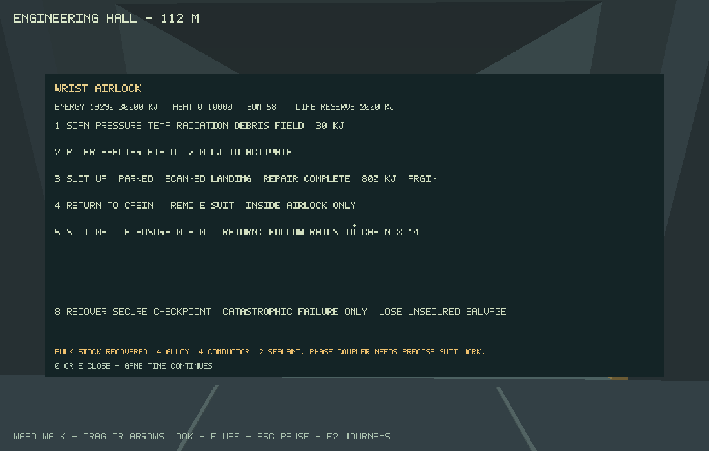
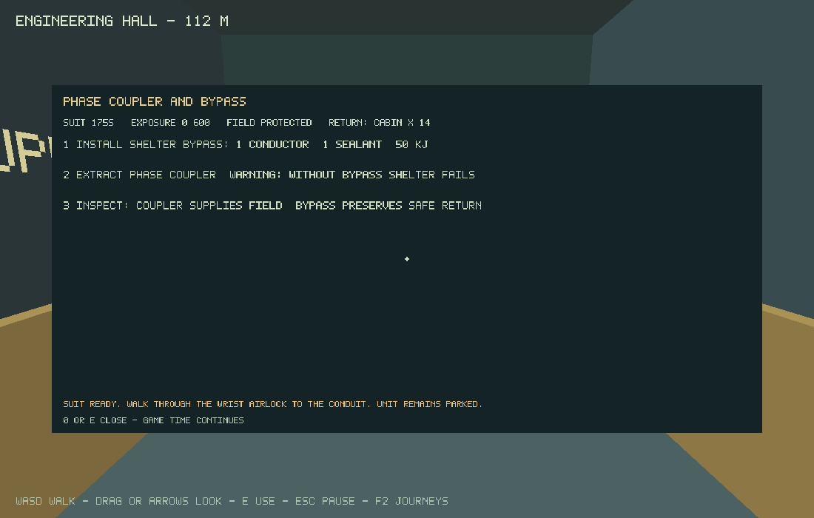
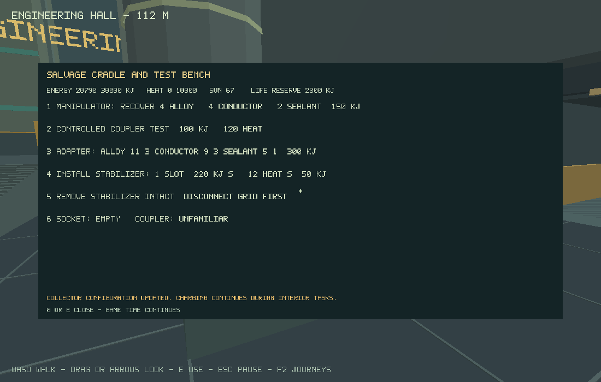

# M1e integrated tower expedition — 4 November 2026

## Implementation and identity

M1a–M1e are implemented on `codex/m1-authored-expedition`; this record belongs to the M1e integration commit. Runtime identity: version 0.1.0, scene `m1-tower-v1`, content 6, schema 2. Numerical rates and the proposed 20–40-minute human loop remain provisional. Human acceptance is deferred at the user's request until after M1, not marked complete. Main/public Pages have not been changed.

The authored route connects helm approach/parking, workshop bus isolation, a predictable grid surge, common-cause fault diagnosis, reserved helper repair, bulk stock recovery, scanned/sheltered suit egress, parallel bypass, precise coupler recovery, physical return, controlled testing/adaptation/installation, and a newly supported west route. The live objective guide follows actual state. Useful solar charging overlaps the interior tasks. Costs/rejections are shared between native and browser station controls. All gameplay stays first person.

Installation adds real support and a matching turquoise bridge at X-260..-80/Z-180..-30. The departure route reverses to Z-90 before turning west so the hull clears the tower buttress. Occupied support cannot be retracted. Native replay revealed and fixed an engineering structural rib that obstructed the airlock approach; no fixture teleport was used to hide it.

## Reproducible verification

Host: Debian 13 x86-64, GCC 14.2.0, Python 3.12.14, Node 24.19.0, CMake 3.31.6, Ninja 1.12.1, SDL 3.4.18. Render device: Mesa 25.0.7 llvmpipe/LLVM 19.1.7, OpenGL 4.5 core. Software rendering is not a reference-device performance claim.

From the MEU checkout, source `.tools/activate.sh` on this Linux machine:

```bash
ASAN_OPTIONS=detect_leaks=0 python3 tools/build.py core --test --sanitizers
LIBGL_ALWAYS_SOFTWARE=1 SDL_AUDIODRIVER=dummy xvfb-run -a python3 tools/build.py native --test --smoke --tour --pilot --lifecycle --persistence --expedition
OPENSPEC_TELEMETRY=0 npm run spec:validate
node --check web/input.js
node --check web/storage.js
npx playwright test --list
```

Results:

- 14/14 native/core groups pass, including fixed-tick charging, capacity, overload, return protection, helper reservations/cancellation/partial reload, atomic fabrication, changed support, every egress gate, outside reload, bypass and catastrophic checkpoint recovery.
- Address/undefined sanitizers pass all 14 groups. LeakSanitizer is disabled because the host runs under ptrace; no leak-check pass is claimed.
- Native OpenGL smoke, interior motion tour, piloting/collision, lifecycle cleanup, and separate-process durable save/read/export/import replays pass.
- The complete M1 SDL replay passes 75 phases, 8524 active ticks, with final robot position approximately X-163.2/Z-89.66, parked on support unavailable before installation. It uses actual SDL key/mouse events from the clean spawn, not direct state mutation, teleports or grants. It publishes via the journey UI and reads a real journal into a fresh simulation.
- Final stock is 8 alloy/6 conductor/4 sealant; energy 20114 kJ. The completed saved journey preserves repair, bulk recovery, bypass, coupler, adapter, installation and completion with the suit removed. The restored state is paused and parked on the extended bridge world.
- All six active OpenSpec changes validate.
- Browser adapters parse; Playwright discovers 66 cases. New cases exercise actual desktop/touch station actions, airlock crossing, bypass/extraction, outside IndexedDB save/reload and installed technology. Browser execution is not claimed locally.

Command logs are retained locally in `.tools/m1-final-native.log` and `.tools/m1-final-asan.log`. CI runs the same Linux expedition through `--expedition`; Windows/native and debug/optimized WebAssembly/browser suites remain required on a capable host. The versioned `tests/fixtures/m1-{airlock,coupler,workshop,bridge}.meu` files are emitted by the real native route and supply portable browser-import checkpoints. Legacy `save-v1.meu` still tests M0 migration; `save-v2.meu` fixes the new initial reference record. The codec also rejects resealed malformed expedition/checkpoint fields without altering live state.

## Captures







## Limits and pending decisions

The native route takes about 142 simulated seconds with optimized inputs and no reading/exploration time. This proves integration, not the proposed 20–40-minute human pacing or maintenance enjoyment. Visual/audio assets are still prototype geometry and existing sound placeholders. The suit site is one authored docking envelope, not unrestricted outdoor walking or generated terrain.

Emscripten compiler and matching browser downloads are blocked by the environment policy at `storage.googleapis.com` and `cdn.playwright.dev`. Changed web/browser and Windows results must be observed in remote CI or another capable setup before claiming platform completion. Earlier M0e remote results do not establish the new branch's correctness. No physical Android/iPhone interaction, GPU/phone performance budget, final supported-device matrix, or user acceptance has been completed.

The [M1 route guide](../m1-expedition.md) gives controls, safe approach, resources, failure recovery and save instructions for the user's deferred test. Keep M0 and all M1 changes open. M2 generation remains unstarted.
