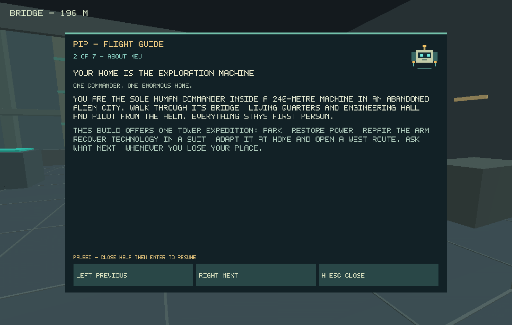

# Pip onboard help - 4 November 2026

User-requested post-M1 onboarding: a hovering guide projection explains the game and the next actionable step. Runtime 0.1.2; scene/content and save schema remain unchanged. M2 and human acceptance remain pending. Work is on `codex/m1-authored-expedition`; main/Pages are unchanged.

## Shared content and progression

`src/game/guide.c` supplies seven topics and 30 next-step states from the real simulation: welcome, docking, isolation/grid/repair, stock, suit/shelter/bypass, safe return, testing/adaptation/installation and west-bridge departure/completion. Safety, low energy, heat, missing parts and renewed faults take precedence where applicable. Help reads state; it never performs a command or grants progress. Native/browser use the same authored content without an external help service.

Help is a transient paused context. It clears held input and helm ownership, blocks start while open, retains frozen resources/job/suit clocks, closes other menus and leaves explicit resume after closing. It is excluded from snapshot bytes.

## Checks so far

Debian 13, GCC 14.2.0, pinned CMake 3.31.6/Ninja 1.12.1. Source `.tools/activate.sh` first.

```bash
python3 tools/build.py core --test
OPENSPEC_TELEMETRY=0 npm run spec:validate
```

All 16 native/core groups and eight active OpenSpec changes pass. The guide test follows production station commands through diagnosis/repair, sheltered bypass recovery, testing, fabrication, installation and completion. It also verifies paused reading is read-only, blocks old actions, preserves snapshot bytes and derives completed guidance after restore. Unit fixture poses do not claim physical navigation; rendered SDL/browser paths remain to be checked.

## Reader and input integration

Pip is a small hovering robot projection in the first-person interface. Click/tap Help or use H/F3. Seven topics have previous/next controls; the web also has a labelled selector, scrollable article and keyboard focus containment. The web reader fits desktop, 360x640 and 640x360 viewports, keeps its 48-pixel controls visible and respects reduced motion. The portrait header was adjusted so the extra control does not overlap mission text. Native uses the same C text with word wrapping and mouse/touch/keyboard topic controls.

The real SDL lifecycle replay opens help before audio starts and while mouse capture/movement are active. It verifies release, unchanged simulation while reading, topic selection, focus loss, closing without resuming, fresh resume and the clickable drone badge. Its help capture is forced onto an actual drawn frame. Native smoke, interior/pilot tours, full expedition and separate-process journey save/reload/export/import pass. The route still finishes in 8531 ticks with 20114 kJ and stock 8/6/4. All 16 address/undefined sanitizer groups pass (`ASAN_OPTIONS=detect_leaks=0`; this host restricts LeakSanitizer under ptrace).

```bash
LIBGL_ALWAYS_SOFTWARE=1 SDL_AUDIODRIVER=dummy xvfb-run -a python3 tools/build.py native --test --smoke --tour --pilot --lifecycle --persistence --expedition
ASAN_OPTIONS=detect_leaks=0 python3 tools/build.py core --test --sanitizers
```

The commands were completed across `.tools/pip-native-full.log`, `.tools/pip-lifecycle.log`, `.tools/pip-native-finish.log` and `.tools/pip-asan.log`; the early full run stopped at an incorrectly aligned replay assertion, subsequently corrected to account for the production frame counter. Rendered checks need an allowed local X display socket in this sandbox. Native device: SDL 3.4.18, Mesa 25.0.7 llvmpipe/LLVM 19.1.7.



The installed Chromium 154 preview checks layout using mock C calls; it is not claimed as Wasm integration evidence. Playwright lists 98 cases. New real-runtime tests cover game explanations before audio, touch sizes/scrolling, reduced motion, capture release, suit clocks/old movement and imported/saved/restored guidance. CI runs focused mouse and Pip cases before the full suite and includes help in optimized/live checks. Cross-platform verification is pending; matching Emscripten/browser downloads remain restricted locally. No physical-device usability, performance or user acceptance is claimed.

The first focused UI run, a0a077b, passed all six captured-mouse cases and 10 of 11 Pip cases. Its portrait engineering header wrapped to 102.56 CSS pixels in the CI font environment, overlapping the old 100-pixel mission origin. The portrait mission region now reserves 120 pixels below the header; the test keeps the same no-overlap assertion. Topic changes also reset the reading position, while focus changes retain the current topic/scroll position. The mobile layout diagnostic verifies real wheel scrolling and reset, but remains separate from full Wasm testing.

Run cbfd6c0 passes Windows/Linux, 15 Wasm groups, six captured-mouse cases and all nine Chromium Pip cases. Two WebKit cases stop at an unsupported test-driver operation: mobile WebKit does not expose mouse-wheel injection. The reader test now focuses the scrollable article and sends End, testing accessible keyboard scrolling without changing gameplay state or weakening the scroll/reset assertions. Other phone help interaction remains touch-driven.

The subsequent End-based run passes WebKit, but catches Chrome carrying keyboard scroll animation into a newly selected topic. An instant scroll alone still allowed the old animation to continue in the landscape diagnostic. Topic changes now replace the reading pane, discarding its old native scroll animation while retaining keyboard focus; unchanged topics retain their position. The reset assertion polls for exactly zero. This addresses the actual interruption rather than waiting for scrolling to finish before changing topics.
